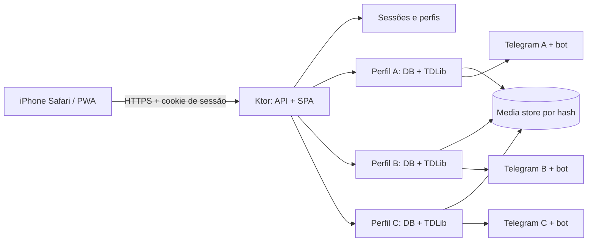

# MLib Server — proposta de implementação (FR-11)

Proposta registada a **22-11-2026**. Não comprometida a versão. Objectivo: permitir que três adultos usem os iPhones para ouvir a biblioteca servida por um servidor caseiro, cada um com **conta Telegram própria**, biblioteca própria e consumo de bot próprio.

Inspiração: o modelo do MCat Player (sessão Telegram por utilizador, config por conta), corrigindo as fragilidades de autenticação, isolamento de media e persistência.

## 1. Âmbito

**Incluído**

- Servidor HTTP com API e UI web (PWA), servido a partir de um CT Proxmox.
- Um perfil por pessoa; cada perfil com login próprio e **sessão TDLib própria** (conta Telegram própria).
- Biblioteca, origens, destino, playlists, favoritas, fila e jobs isolados por perfil.
- Streaming por HTTP Range a partir dos ficheiros locais; sem transcode no MVP.
- Aquisição pelo bot por perfil, com fila, progresso, cancelamento (`/cancel`) e retoma.
- Acesso em casa por LAN; fora por Tailscale ou Cloudflare Tunnel + Access.

**Excluído (por agora)**

- Offline nos iPhones e app nativa iOS/App Store.
- Multi-tenant com uma só conta Telegram partilhada.
- Transcode, gapless/crossfade, Android Auto na web.
- Sync entre instâncias; o histórico de reprodução fica sempre local.

## 2. Arquitectura

### Componentes

1. **`mlib-core`** (novo módulo JVM): lógica sem Android/Compose — modelo, regras de aquisição, `Library` SQLite, conhecimento, conclusão de álbuns. Extraído de `shared` por camadas, sem reescrever regras.
2. **`mlib-server`** (Ktor): API JSON, autenticação, perfis, media, jobs, SSE para progresso.
3. **`mlib-web`** (SPA TypeScript; React ou Svelte): PWA, player por `<audio>`, Media Session API, manifest.
4. **`libtdjson` + JNA**: cliente TDLib por perfil, com directório e chave de cifra próprios. Evita depender do JNI Android e permite Linux.
5. **Media store**: ficheiros guardados por SHA-256, partilhados entre perfis com contagem de referências.

### Porque não reutilizar a UI Compose

A UI actual é Compose Android com dependências de plataforma. O ganho de a reutilizar não compensa o acoplamento; a web deve ser uma SPA própria. O que se reutiliza é **domínio e regras**, não ecrãs.

## 3. Modelo de dados

Uma base SQLite **por perfil** (isolamento simples, backup e quota triviais) e uma base global de media/refcount.

Perfil:

- `accounts(id, username, password_hash, role, created_at, disabled)`
- `sessions(token_hash, account_id, created_at, last_seen, expires_at, ip, user_agent)`
- `telegram(id, account_id, tdlib_dir, encryption_key_ref, phone, user_id, username, state)`
- `settings(key, value)`
- `sources(chat_id, title, can_post, active, added_at)`
- `tracks(id, telegram_chat_id, telegram_message_id, media_id, title, artist, album, duration, liked, added_at, …)`
- `albums(id, title, artist, year, cover, track_ids)`
- `playlists(id, name, cover, track_ids, created_at)`
- `jobs(id, kind, query, status, items_json, created_at, updated_at)`
- `likes(track_id, created_at)`
- `play_state(track_id, position_ms, updated_at)`

Global:

- `media(id, sha256, path, size, mime, bitrate, created_at)`
- `media_refs(media_id, account_id, track_id)` para refcount e limpeza segura.

Regras:

- O `media_id` só é servido se existir um `track` visível do perfil que o referencia.
- Limpar cache/offline de um perfil só apaga o ficheiro quando `media_refs` fica vazio.
- `liked` por perfil; o mesmo ficheiro pode ser favorito para um e não para outro.

## 4. Autenticação e sessões

- Registo por convite do administrador; `username` + password com **Argon2id** (parâmetros calibrados no servidor).
- Login: rate limit por IP e por conta, atraso progressivo, log de tentativas.
- Sessão: token aleatório 256-bit, guardado como hash na BD; cookie `HttpOnly; Secure; SameSite=Lax`, `Max-Age` 30 dias, rotação no login e no uso de TOTP.
- **CSRF**: token por sessão em pedidos que mudam estado; rotas de escrita exigem `Origin` válido.
- Opcional: TOTP por perfil; “terminar sessão em todos os dispositivos”.
- Papéis: `admin` (gere contas, Telegram, quotas, backups) e `listener` (só o seu perfil).
- **Nunca** expor `StringSession` ao cliente: a sessão TDLib fica cifrada no servidor e é gerida pelo processo.

## 5. Telegram por perfil

- Um cliente `libtdjson` por perfil, com `database_directory = data/profiles/{id}/tdlib` e chave de cifra por perfil (envelope: chave mestra do servidor + chave do perfil).
- Login web por telefone → código → 2FA, ou QR; o servidor conduz o TDLib e nunca devolve credenciais.
- Estado por perfil: `authorizationStateReady/Closed/WaitPhoneNumber/...`, apresentado na UI.
- Logout do Telegram pelo admin/perfil: `logOut` no TDLib e remoção do estado local.
- Origens: chats onde o bot colocou áudio; destino: chat escolhido pelo perfil; cada perfil pode ter várias origens.
- Jobs: um por perfil em execução (a conversa do bot é estado único), persistidos na BD do perfil; progresso por SSE; cancelar envia `/cancel` ao bot.

## 6. Media e streaming

- Endpoint `GET /api/media/{trackId}`:
  1. valida sessão;
  2. resolve o `track` no perfil;
  3. confirma que o `media` existe;
  4. responde com `Accept-Ranges` e `206` quando pedido.
- Nunca servir por caminho de ficheiro nem por `chatId/messageId` arbitrário.
- Download do Telegram só quando necessário; gravar por hash; refcount.
- Limpeza LRU opcional por perfil, respeitando `media_refs`.
- Sem transcode no MVP: MP3/AAC/FLAC servidos como estão (Safari reproduz FLAC).
- Limite de concorrência por perfil configurável; o servidor faz apenas I/O.

## 7. UI web (PWA)

- Ecrãs: Entrar, Início, Biblioteca (faixas/álbuns/artistas/playlists), Procurar, Álbum, Artista, Playlist, Jobs, Definições, Administração.
- Player fixo no fundo: capa, título, progresso, play/pause, seguinte, volume; Media Session para lockscreen.
- “Adicionar ao ecrã inicial” com manifest, ícones e `display: standalone`.
- Estados: esqueletos, vazios com ação, erros com “Tentar novamente”.
- Acessibilidade: foco visível, alvos ≥44 px, contraste AA nos temas claro/escuro/AMOLED/alto contraste.

## 8. Operação

- **Empacotamento**: imagem Docker `mlib-server` e pacote systemd para CT; volumes `library/`, `data/`, `cache/`.
- **CT recomendado (3 perfis)**: 2 vCPU, **2 GB RAM**, 16 GB de disco do CT + bind mount da biblioteca; `nesting=1` só se usares Docker dentro do LXC.
- **Alternativa**: um CT por perfil (1 vCPU, 1 GB), se quiseres isolamento físico e quotas independentes.
- **Proxy**: Caddy no CT com TLS interno/Let’s Encrypt; exposição pública via Cloudflare Tunnel + Access, ou privada via Tailscale.
- **Backups**: snapshot do CT (pequeno) + dump SQLite cifrado por perfil; media no dataset do host com snapshots próprios.
- **Observabilidade**: log estruturado, endpoint `/healthz`, métricas simples (RAM, streams activos, pedidos ao bot, FloodWait).

## 9. Segurança

- TLS obrigatório; HSTS; CSP restritiva; `X-Content-Type-Options`, `Referrer-Policy`.
- Sem segredos no repositório; `TG_API_ID`/`TG_API_HASH` por ambiente.
- Autorização em cada endpoint (nunca confiar em IDs do cliente).
- Cifra das bases TDLib; chave mestra fora do CT (env/ficheiro com permissões restritas).
- Rate limiting em login, pesquisa e jobs; limite de streams concorrentes.
- Logs sem tokens, telefones ou caminhos de media.

## 10. Fases e estimativas

| Fase | Entrega | Estimativa |
|---|---|---|
| P0 | Extrair `mlib-core`, esqueleto Ktor, um perfil, streaming por Range, PWA mínima | 2–3 semanas |
| P1 | Auth, sessões, perfis, DB por perfil, administração | 1–2 semanas |
| P2 | TDLib por perfil, login web, origens/destino, jobs persistidos, `/cancel` | 2–3 semanas |
| P3 | UI completa (início, biblioteca, álbuns/artistas, playlists, jobs), PWA iOS | 2 semanas |
| P4 | Docker/systemd, backups, quotas, monitorização, documentação de instalação | 1 semana |

Total: **8–12 semanas** a tempo parcial, sem contar dedup por fingerprint (FR-02) nem sync.

## 11. Critérios de aceitação

- Três contas com sessões Telegram distintas; derrubar uma não afecta as outras.
- Um perfil só vê e reproduz as suas origens; tentar acessos cruzados devolve 403/404.
- Streaming com seek em iOS Safari e PWA instalada; áudio continua em background.
- Reinício do servidor preserva perfis, jobs e posições; sessões web continuam válidas.
- Cancelar uma obtenção envia `/cancel` e marca o job como cancelado, sem afectar outros perfis.
- Nenhum endpoint serve media sem sessão e visibilidade.
- Snapshot + restauro de um perfil produzem o mesmo estado.

## 12. Riscos

| Risco | Mitigação |
|---|---|
| Memória de múltiplas sessões TDLib | Medir; começar com 2 GB; separar CTs se necessário |
| Regressões de autorização | Testes de integração por perfil; revisão dedicada |
| Fuga de media em cache | Autorização por `trackId`; nunca por caminho |
| Limites do Telegram por conta | Cada conta tem a sua quota; backoff e FloodWait visível |
| iOS suspender áudio em background | Validar cedo em dispositivo real; fallback “manter ecrã ligado” |
| Scope creep | Fases fechadas com critérios; sem transcode nem offline no MVP |
