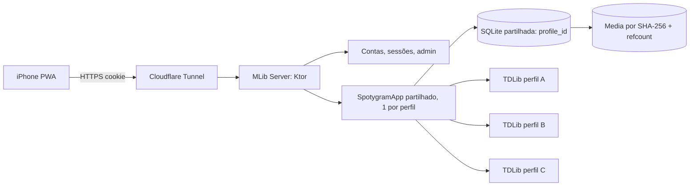

# MLib Server — proposta de implementação (FR-11)

Actualizada a **22-11-2026** com as decisões do owner. Substitui a estimativa anterior.

## 0. Decisões fixadas

- **Um CT Proxmox**, um único processo de servidor.
- **BD partilhada** (um SQLite com `profile_id`), não uma base por perfil.
- **Contas criadas apenas pelo administrador** numa página de gestão; sem registo público.
- **Sem transcode** no MVP.
- Publicação por **Cloudflare Tunnel** em domínio próprio (`mlib.ginjeira.com`).
- Um perfil por adulto, **com conta Telegram própria**, biblioteca e consumo de bot isolados.
- iOS por **PWA** (Safari + ecrã inicial). Sem offline, sem App Store, sem sideload.

## 1. O que já existe e é reutilizável (com evidência)

| Peça | Estado | Onde |
|---|---|---|
| Abstracção de plataforma (ficheiros, prefs, locale, DB, TDLib) | Pronta | `shared/.../Platform.kt` |
| Cliente TDLib por JSON, multi-instância | Pronto | `desktop/.../DesktopNative.kt` (`td_create_client_id` por cliente), `Telegram.kt` |
| Base de dados abstracta (`SqlDatabase`, `SqlCursor`) | Pronta | `Platform.kt`; implementações Android e desktop |
| Modelo de biblioteca sem Android | Pronto | `Library.kt` importa apenas `java.*`, `kotlinx`, `org.json` |
| Autenticação Telegram (estado, código, 2FA, QR) | Lógica pronta | `Telegram.kt` |
| Aquisição, revisão, commit, jobs persistidos, `/cancel` | Pronto | `MusicAcquisition.kt` |
| Conhecimento, completude, artistas, capas | Pronto | `Knowledge.kt`, `AlbumCompletion.kt`, `ArtistCatalog.kt` |
| Texto/localização em JVM | Pronto | `DesktopPlatform.text` |

**Só a UI Compose, serviços Android, notificações, playback service e app lock são específicos de Android** e não entram no servidor. O cliente web substitui-os.

## 2. Trabalho genuinamente novo

1. **`ServerPlatform`** (JVM): `filesDir` por perfil, preferências em ficheiro, `openDatabase` via JDBC, `tdlib` via `DesktopTdClient`, `downloadFile` para a pasta do perfil.
2. **Gestor de downloads do servidor**: substituir o serviço Android por uma fila no processo que usa `downloadFile` do TDLib e move para `data/profiles/{id}/music`.
3. **Multi-perfil num só processo**: remover singletons globais (`AppText`, `Knowledge`, notificações) ou passá-los a instância; adicionar `profile_id` a playlists, sources, settings, downloads e jobs (tracks já tem `profile_user`/`profile_position`).
4. **API HTTP** (Ktor): auth, biblioteca, pesquisa, playlists, jobs (SSE), media, administração.
5. **SPA web** (TypeScript; React ou Svelte): login, Início, Biblioteca, Procurar, Álbum, Artista, Playlist, Player, Jobs, Administração.
6. **Operação**: imagem/systemd, healthcheck, backups, documentação de instalação.

## 3. Arquitectura

- Um processo JVM; um `SpotygramApp` por perfil (contextos isolados), uma BD partilhada.
- Um cliente TDLib por perfil, com `database_directory` e `files_directory` próprios e chave de cifra por perfil.
- Mídia partilhada por hash; visibilidade por perfil e autorização em cada pedido.
- Fallback se a refactor dos singletons crescer: **um JVM por perfil** atrás de um pequeno gateway (custa +700–900 MB de RAM).

## 4. Modelo de dados (BD partilhada)

Acrescentar `profile_id` a:

- `tracks` — já tem `profile_user`/`profile_position`; confirmar semântica e indexar.
- `playlists` e `playlist_tracks` (via playlist).
- `sources`, `downloads`, `settings` (chave composta `profile_id, key`).
- `jobs` e itens de job.
- `liked` — hoje coluna em `tracks`; passar a `likes(profile_id, track_id)`.

Global: `profiles`, `sessions`, `media(id, sha256, path, size, mime)`, `media_refs(media_id, profile_id)`.

Regras:
- Um `track` só é servido se pertencer ao perfil autenticado.
- Refcount impede que apagar offline num perfil remova ficheiro usado por outro.
- Um dump SQLite cobre todos os perfis; restauro selectivo por `profile_id`.

## 5. Autenticação e administração

- Contas criadas pelo admin; `username` + password com **Argon2id**; sem auto-registo.
- Sessão: token 256-bit, hash na BD, cookie `HttpOnly; Secure; SameSite=Lax`, 30 dias, rotação.
- CSRF em escritas; rate limit por IP/conta; log de tentativas.
- Papéis `admin`/`listener`; admin gere contas, Telegram, quotas e backups.
- `/admin` protegido também por **Cloudflare Access** (email OTP), além do login local.
- `StringSession`/estado TDLib **nunca** chega ao browser.

## 6. Media e streaming

- `GET /api/media/{trackId}`: valida sessão → resolve track do perfil → confirma media → `206` com `Range`.
- Nunca servir por caminho nem por `chatId/messageId` arbitrário.
- Download do Telegram apenas quando necessário; gravar por hash; refcount; sem transcode.
- MP3/AAC/FLAC servidos como estão; Safari reproduz os três.

## 7. UI web (MVP)

- Entrar; Início; Biblioteca (Faixas/Álbuns/Artistas/Playlists); Procurar; Álbum; Artista; Playlist; Jobs; Definições; Administração.
- Player fixo: capa, título, progresso, play/pause, seguinte; Media Session.
- PWA: manifest, ícones, `standalone`; “Adicionar ao ecrã inicial”.
- Skeletons, estados vazios com ação, erros com retry; foco visível, alvos ≥44 px.

## 8. Operação

- **CT**: 2 vCPU, **2 GB RAM**, 12–16 GB de disco + bind mount da biblioteca.
- **Sem transcode**: CPU em repouso quase nula; picos só em sync/download.
- **Tunnel**: `cloudflared` no CT, `mlib.ginjeira.com`; TLS na Cloudflare; sem portas abertas.
- **Backups**: snapshot do CT + dump SQLite; media no dataset do host.
- **Logs** estruturados, `/healthz`, métricas de streams activos e FloodWait.

## 9. Fases e previsão realista

Dias de trabalho **focados** (não semanas de calendário). Reutilização agressiva; UI sem “polish” de produto.

| Fase | Entrega | Dias |
|---|---|---|
| P0 | `ServerPlatform`, arranque do `SpotygramApp`, um perfil, biblioteca, streaming Range | 3–4 |
| P1 | Auth, sessões, admin, tabela `profiles`, BD partilhada com `profile_id` | 2–3 |
| P2 | Multi-perfil num processo, singletons por instância, TDLib por perfil, downloads do servidor, login Telegram via API | 4–6 |
| P3 | SPA MVP (ecrãs acima, player, jobs, admin) | 5–8 |
| P4 | Deploy, Tunnel, backups, testes de autorização, documentação | 2–3 |
| **Total** | MVP familiar funcional | **16–24 dias** |

- **Focado, a tempo inteiro**: 3–5 semanas de calendário.
- **Noites/fins de semana (~15 h/semana)**: 5–7 semanas.
- **MVP mínimo** (Início/Biblioteca/Procurar/Player/Jobs, sem Álbum/Artista/administração polida): **10–14 dias**.

O que pode esticar: build e empacotamento do `libtdjson` em Linux, áudio em background no iOS, bugs de scoping na BD partilhada, e o player web (seek/Media Session). O que **não** estica: aquisição, conhecimento, biblioteca e jobs — já existem.

## 10. Custo em recursos (3 perfis, 1 CT)

| Recurso | Valor |
|---|---|
| RAM base (JVM + Ktor + SQLite) | 350–500 MB |
| Por sessão TDLib | +120–200 MB em repouso; +300–400 MB no 1.º sync |
| Total 3 perfis | **1,1–1,6 GB** (2 GB com margem) |
| vCPU | 2 (repouso <5%) |
| Disco do CT | 10–16 GB |
| Biblioteca | bind mount (tamanho real) |
| Rede | 0,3–1 Mbps por stream; Tunnel sem custo |
| Dinheiro | 0 €/mês (domínio já existente, Tunnel e TLS gratuitos; só eletricidade) |

## 11. Critérios de aceitação

- Contas criadas só pelo admin; login por cookie; sessão sobrevive a reinício do servidor.
- Cada perfil tem a sua conta Telegram, origens, destino, playlists, favoritas e jobs.
- Acesso cruzado a track/media devolve 403/404, mesmo com IDs válidos.
- Streaming com seek em iOS Safari e na PWA; áudio continua em background.
- Cancelar obtenção envia `/cancel` e não afecta outros perfis.
- Um dump SQLite restaura todos os perfis; mídia referenciada continua reproduzível.

## 12. Riscos

| Risco | Mitigação |
|---|---|
| Singletons globais (AppText, Knowledge) | Passar a instância; fallback: um JVM por perfil |
| `libtdjson` em Linux | Reutilizar o carregamento JNA do desktop; validar cedo |
| Isolamento na BD partilhada | Testes de integração por perfil antes da UI |
| iOS suspender áudio | Validar na P3, em dispositivo real |
| Scope creep | Sem transcode, sync, offline ou App Store no MVP |
